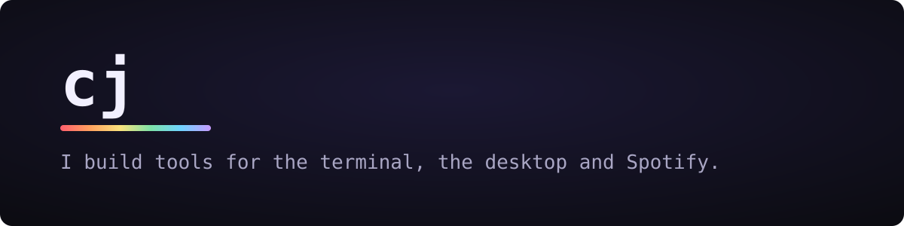

  <picture>
    <source media="(prefers-color-scheme: dark)" srcset="assets/banner-dark.svg">
    <source media="(prefers-color-scheme: light)" srcset="assets/banner-light.svg">
    
  </picture>

  
  
  
  
  

## What I'm building

<table>
  <tr>
    <td width="33%" valign="top">
      
      <h3><a href="https://github.com/sjdsjadjajdjsa/prism">Prism</a></h3>
      Free AI coding assistant for your terminal and browser. Runs on free models or the plan you already pay for.
       Go · Docker
    </td>
    <td width="33%" valign="top">
      
      <h3><a href="https://github.com/sjdsjadjajdjsa/hanami">Hanami</a></h3>
      A small game launcher for Linux and Windows, with falling sakura petals.
       Rust · Slint
    </td>
    <td width="33%" valign="top">
      
      <h3><a href="https://github.com/sjdsjadjajdjsa/afterglow-viz">afterglow-viz</a></h3>
      Audio-reactive visualizer and ambient backdrop for Spotify.
       TypeScript · Spicetify
    </td>
  </tr>
</table>

Also: [ttyfy](https://github.com/sjdsjadjajdjsa/ttyfy-theme), a terminal-style theme for Spotify.

## Activity

<picture>
  <source media="(prefers-color-scheme: dark)" srcset="https://raw.githubusercontent.com/sjdsjadjajdjsa/sjdsjadjajdjsa/output/github-snake-dark.svg">
  <source media="(prefers-color-scheme: light)" srcset="https://raw.githubusercontent.com/sjdsjadjajdjsa/sjdsjadjajdjsa/output/github-snake.svg">
  
</picture>
