<picture><source media="(prefers-color-scheme: dark) and (max-width: 600px)" srcset="https://raw.githubusercontent.com/sjdsjadjajdjsa/sjdsjadjajdjsa/output/now-dark-mobile.svg"><source media="(prefers-color-scheme: light) and (max-width: 600px)" srcset="https://raw.githubusercontent.com/sjdsjadjajdjsa/sjdsjadjajdjsa/output/now-light-mobile.svg"><source media="(prefers-color-scheme: dark)" srcset="https://raw.githubusercontent.com/sjdsjadjajdjsa/sjdsjadjajdjsa/output/now-dark.svg"><source media="(prefers-color-scheme: light)" srcset="https://raw.githubusercontent.com/sjdsjadjajdjsa/sjdsjadjajdjsa/output/now-light.svg"></picture>
