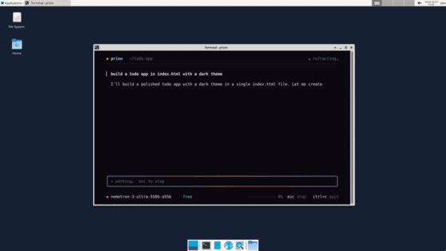
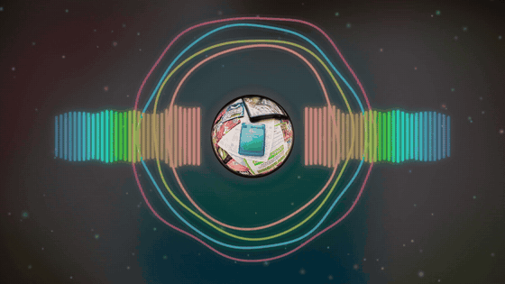

  <picture><source media="(prefers-color-scheme: dark)" srcset="assets/banner-dark.svg"><source media="(prefers-color-scheme: light)" srcset="assets/banner-light.svg"></picture>

## What I'm building

<table>
  <tr>
    <td width="33%" valign="top">
      
      <h3><a href="https://github.com/sjdsjadjajdjsa/prism">Prism</a></h3>
      Free AI coding assistant for your terminal and browser.
       Go · Docker
    </td>
    <td width="33%" valign="top">
      
      <h3><a href="https://github.com/sjdsjadjajdjsa/hanami">Hanami</a></h3>
      A small game launcher for Linux and Windows, with falling sakura petals.
       Rust · Slint
    </td>
    <td width="33%" valign="top">
      
      <h3><a href="https://github.com/sjdsjadjajdjsa/afterglow-viz">afterglow-viz</a></h3>
      Audio-reactive visualizer and ambient backdrop for Spotify.
       TypeScript · Spicetify
    </td>
  </tr>
</table>

### More

<a href="https://github.com/sjdsjadjajdjsa/tonal"><picture><source media="(prefers-color-scheme: dark)" srcset="https://raw.githubusercontent.com/sjdsjadjajdjsa/sjdsjadjajdjsa/output/repo-tonal-dark-l.svg"><source media="(prefers-color-scheme: light)" srcset="https://raw.githubusercontent.com/sjdsjadjajdjsa/sjdsjadjajdjsa/output/repo-tonal-light-l.svg"></picture></a><a href="https://github.com/sjdsjadjajdjsa/rhythia-is-trash"><picture><source media="(prefers-color-scheme: dark)" srcset="https://raw.githubusercontent.com/sjdsjadjajdjsa/sjdsjadjajdjsa/output/repo-rhythia-is-trash-dark-r.svg"><source media="(prefers-color-scheme: light)" srcset="https://raw.githubusercontent.com/sjdsjadjajdjsa/sjdsjadjajdjsa/output/repo-rhythia-is-trash-light-r.svg"></picture></a><a href="https://github.com/sjdsjadjajdjsa/pg3d-rewrite"><picture><source media="(prefers-color-scheme: dark)" srcset="https://raw.githubusercontent.com/sjdsjadjajdjsa/sjdsjadjajdjsa/output/repo-pg3d-rewrite-dark-l.svg"><source media="(prefers-color-scheme: light)" srcset="https://raw.githubusercontent.com/sjdsjadjajdjsa/sjdsjadjajdjsa/output/repo-pg3d-rewrite-light-l.svg"></picture></a><a href="https://github.com/sjdsjadjajdjsa/ttyfy-theme"><picture><source media="(prefers-color-scheme: dark)" srcset="https://raw.githubusercontent.com/sjdsjadjajdjsa/sjdsjadjajdjsa/output/repo-ttyfy-theme-dark-r.svg"><source media="(prefers-color-scheme: light)" srcset="https://raw.githubusercontent.com/sjdsjadjajdjsa/sjdsjadjajdjsa/output/repo-ttyfy-theme-light-r.svg"></picture></a>

## Right now

<picture><source media="(prefers-color-scheme: dark)" srcset="https://raw.githubusercontent.com/sjdsjadjajdjsa/sjdsjadjajdjsa/output/now-dark.svg"><source media="(prefers-color-scheme: light)" srcset="https://raw.githubusercontent.com/sjdsjadjajdjsa/sjdsjadjajdjsa/output/now-light.svg"></picture>
